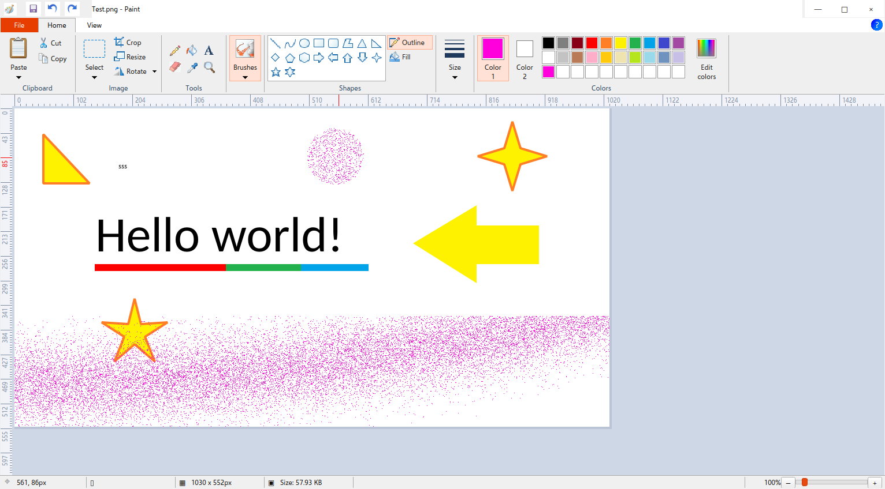

# MSPaint Rewritten Linux

Adaptación nativa Linux del proyecto MIT [mspaint-rewritten de Codrut](https://github.com/Codrax/mspaint-rewritten), conservando las correcciones de [ripDZL/core-stability-phase1](https://github.com/ripDZL/mspaint-rewritten/tree/fix/core-stability-phase1).

**Preview 0.1.0:** port nativo con la cinta, disposición y recursos gráficos del formulario Delphi original. Incluye texto editable dentro del lienzo, tiradores de selección y formas, reglas exteriores, propiedades y ventanas de visualización. La captura corresponde a la aplicación ejecutándose en Linux. Consulta [cobertura y diferencias](docs/PORTING.md), [revisión Windows](docs/UPSTREAM-REVIEW.md) y [validación](docs/VALIDATION.md).



## Descargas

[Releases](https://github.com/xXKuroiKenshiXx/mspaint-rewritten-linux/releases): AppImage, `.deb`, Flatpak y portable `.tar.gz`. Comprueba `SHA256SUMS`. Los paquetes locales de esta preview son x86_64.

### AppImage

Requiere un escritorio Linux glibc 2.39 o posterior con OpenGL/EGL. Alternativa sin FUSE:

```sh
chmod +x mspaint-rewritten-linux-0.1.0-x86_64.AppImage
./mspaint-rewritten-linux-0.1.0-x86_64.AppImage
./mspaint-rewritten-linux-0.1.0-x86_64.AppImage --appimage-extract-and-run
```

### Debian/Ubuntu

```sh
sudo apt install ./mspaint-rewritten-linux_0.1.0_amd64.deb
```

### Flatpak, incluido Void

Instala Flatpak y el backend `xdg-desktop-portal` de tu escritorio. Flathub proporciona el runtime; este proyecto no está publicado en Flathub.

```sh
flatpak remote-add --user --if-not-exists flathub https://flathub.org/repo/flathub.flatpakrepo
flatpak install --user flathub org.freedesktop.Platform//25.08
flatpak install --user ./mspaint-rewritten-linux-0.1.0-x86_64.flatpak
flatpak run io.github.xXKuroiKenshiXx.MSPaint
```

El sandbox permite Pictures, gráficos y CUPS; no solicita red ni todo el directorio personal. Otros archivos se abren mediante el diálogo/portal del escritorio. En Void musl usa Flatpak, no el AppImage glibc.

## Desde fuentes

Python 3.10 o posterior y bibliotecas gráficas del sistema. Ejemplo Ubuntu:

```sh
sudo apt install python3-venv libgl1 libegl1 libopengl0 libxkbcommon-x11-0 libxcb-cursor0 libxcb-icccm4 libxcb-keysyms1
cd linux
python3 -m venv .venv
. .venv/bin/activate
python -m pip install --upgrade pip
python -m pip install -r requirements.txt
python -m mspaint
```

## Desarrollo y paquetes

```sh
cd linux
python -m pip install -r requirements-dev.txt
QT_QPA_PLATFORM=offscreen python -m pytest -q
bash scripts/download-third-party.sh
bash scripts/build.sh
sudo python scripts/download-system-sources.py
bash scripts/build-appimage.sh
bash scripts/build-flatpak.sh
```

`build.sh` requiere `dpkg-deb`; AppImage requiere `curl` y squashfs-tools; Flatpak requiere flatpak-builder y Freedesktop Sdk/Platform 25.08. Artefactos: `linux/dist/packages`. Los fuentes de terceros acompañan los binarios. GitHub Actions ejecuta pruebas y genera artefactos sin publicar releases automáticamente.

## Windows y licencias

La raíz conserva Delphi y su historial. Windows 11 está **sin verificar**: faltan compilador Delphi y dependencias visuales para probarlo. La revisión documenta también problemas residuales de estabilidad.

Proyecto: [MIT](LICENSE). Qt/PySide6: LGPL-3.0; Python, Pillow y demás bibliotecas tienen sus propias licencias. Los paquetes contienen avisos/inventario y permiten reemplazar bibliotecas compartidas. Los fuentes correspondientes de terceros acompañan la release. No se modificó Qt. GIF es un formato y marca de servicio de CompuServe.
